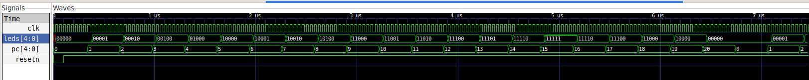
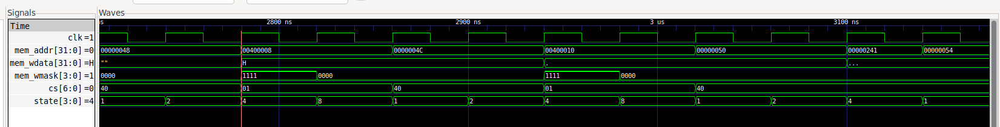

# Semana 1 — del contador al procesador

**Electrónica Digital I · Grupos 9 y 10**

Este informe responde las cinco tareas de la Semana 1 del laboratorio: blinker desde memoria, primer programa en el FemtoRV, mapa de memoria, recorrido interno del procesador y seguimiento de una escritura desde C hasta el bus.

Guía de actividades: [`Labs/lab-femtorv/lab-femtorv/Semana1.md`](Labs/lab-femtorv/lab-femtorv/Semana1.md).

## Tarea 1. Blinker desde memoria

### Diagrama funcional

```text
clk (25 MHz en simulación)
          │
          ▼
 divisor de 3 bits ── tick ──► PC de 5 bits ── dirección ──► ROM (21 × 5 bits)
                                      ▲                              │
                                      └──── vuelve a 0 tras 20       ▼
                                                           registro dato (5 bits)
                                                                     │
                                                                     ▼
                                                                 LEDs[4:0]
```

El divisor genera un `tick`; el contador de programa (`PC`) selecciona una palabra de la ROM, y la palabra leída se registra para conducir los cinco LEDs. El reset activo en bajo pone el `PC` en cero.

### Primeras ocho posiciones: predicción y simulación

Los valores se copian de `MEM[PC]` en `blinker/rtl/blinker.v`. La simulación coincide con la predicción:

La predicción y la simulación para las primeras ocho posiciones coincidieron:

| PC | Predicción de LEDs | Simulación de LEDs |
|---:|:---:|:---:|
| 0 | `00000` | `00000` |
| 1 | `00001` | `00001` |
| 2 | `00010` | `00010` |
| 3 | `00100` | `00100` |
| 4 | `01000` | `01000` |
| 5 | `10000` | `10000` |
| 6 | `10001` | `10001` |
| 7 | `10010` | `10010` |

Comando ejecutado: `cd Labs/lab-femtorv/lab-femtorv/blinker && make sim`. La salida recorrió los PC de 0 a 20, volvió al inicio y mostró los patrones almacenados en la ROM.

La captura de GTKWave muestra el recorrido del PC y la palabra correspondiente en `leds[4:0]` en formato binario. Cada uno de los cinco bits controla un LED (1 = encendido, 0 = apagado). La ROM primero enciende un LED a la vez, desplazando el bit activo hacia la izquierda (`00001`, `00010`, `00100`, `01000`, `10000`). Luego conserva encendido el bit más significativo y agrega los otros LEDs progresivamente hasta `11111`; finalmente recorre los patrones en sentido inverso hasta `00000`. No es una cuenta binaria consecutiva, sino la secuencia de patrones programada explícitamente en `MEM[0:20]`.



### Divisor y tiempo por paso

El testbench configura `DIV_BITS = 3`, por lo que `divisor` tiene ocho estados. Como cuenta de cero a siete y el `tick` está activo cuando vale cero, el pulso se repite cada $2^3 = 8$ flancos de reloj. Con periodo de reloj de 40 ns:

$$
8\ \text{ciclos}\times 40\ \text{ns/ciclo}=320\ \text{ns por paso}
$$

Por tanto, el PC avanza cada 8 ciclos, equivalentes a 320 ns. La secuencia completa tiene 21 posiciones:

$$
21\times 8=168\ \text{ciclos}
$$

$$
168\times 40\ \text{ns}=6720\ \text{ns}=6.72\ \mu\text{s}
$$

El registro `dato` toma `MEM[PC]` en un `always @(posedge clk)`. Como tanto `PC` como `dato` se actualizan con asignaciones no bloqueantes en flancos de reloj, en el flanco en que cambia el PC, `dato` todavía captura el valor de la dirección anterior. En el flanco siguiente captura el nuevo valor; por eso los LEDs muestran el patrón del nuevo PC con un ciclo de latencia.

### Cálculo para las tarjetas

En la Tang Nano 9K, el divisor tiene `DIV_BITS = 22`, así que un paso tarda $2^{22}=4\,194\,304$ ciclos. Se sintetizó y cargó el blinker en la tarjeta; se observó que el patrón de LEDs recorre la secuencia y vuelve al inicio. El ciclo se verificó visualmente, pero no se midió con cronómetro.

| Tarjeta | Frecuencia | Tiempo por paso | Tiempo para 21 pasos |
|---|---:|---:|---:|
| Colorlight 5A-75E | 25 MHz | 0.16777216 s | 3.52321536 s |
| Tang Nano 9K | 27 MHz | 0.15534459 s | 3.26223644 s |

Estos tiempos son cálculos teóricos basados en las frecuencias nominales. En Tang Nano el top invierte las salidas porque sus LEDs físicos son activos en bajo; los tiempos anteriores corresponden a la secuencia lógica interna del blinker.

### De blinker a procesador

Al circuito del blinker habría que añadir, como mínimo, un decodificador de instrucciones y lógica de control para interpretar lo leído de memoria, una ALU para ejecutar operaciones, registros para guardar operandos y resultados, una interfaz para escribir datos en memoria y lógica de salto para cambiar el PC según la instrucción. La ROM ya no contendría patrones para LEDs, sino instrucciones.

El bloque que interpretaría esas instrucciones sería el **decodificador de instrucciones**, junto con la unidad de control que activa las operaciones correspondientes. El FemtoRV incluye esos bloques.

## Tarea 2. Primer programa en el FemtoRV

### Compilación y simulación

Se ejecutó `cd Labs/lab-femtorv/lab-femtorv/soc && make -B sim`. `-B` fuerza la reconstrucción del firmware para que también aparezca el conteo de palabras. El proceso traduce `hola.c` a instrucciones RISC-V, genera `firmware.hex` y `build/firmware.lst`, compila el SoC con Icarus Verilog y simula la salida serial.

Resultado obtenido:

```text
firmware.hex: 196 de 8192 palabras usadas (2.4 %)
=== Simulacion del SoC: salida de la UART ===
Hola desde el FemtoRV
Por software (sumas repetidas): 5535
Por hardware (periferico MULT): 5535
Grupo 5: Sebastian Cespedes, Juan Jose Mora, Felipe Cardenas
Fin. El programa queda en un bucle infinito.

=== Fin: 177749 ciclos simulados, 207 caracteres recibidos, LEDS_EXT = 00000000 ===
```

El programa ocupa 196 palabras de las 8192 disponibles en la RAM (2.4 %) y el testbench contó 177749 ciclos. Las dos maneras de calcular $123\times45$ dieron 5535. La línea del grupo ya está incluida en `soc/firmware/hola.c`.

### Implementación y prueba en la Tang Nano 9K

Se sintetizó el SoC para la Tang Nano 9K, se cargó el bitstream en la FPGA por USB/JTAG y se reinició la tarjeta con S1. La salida de UART recibida en `/dev/ttyUSB1` a 115200 baudios fue:

```text
Hola desde el FemtoRV
Por software (sumas repetidas): 5535
Por hardware (periferico MULT): 5535
Grupo 5: Sebastian Cespedes, Juan Jose Mora, Felipe Cardenas
Fin. El programa queda en un bucle infinito.
```

La síntesis/place-and-route pasó para el reloj de 27 MHz de la tarjeta y reportó:

| Recurso o métrica | Resultado |
|---|---:|
| LUT4 | 2147 / 8640 (24 %) |
| DFF | 618 / 6480 (9 %) |
| BSRAM | 16 / 26 (61 %) |
| IOB | 11 / 276 (3 %) |
| Frecuencia máxima | 51.57 MHz |

La frecuencia máxima reportada supera la frecuencia objetivo de 27 MHz; el flujo indicó PASS.

También se sintetizó y cargó el blinker para la Tang Nano; se observó que el patrón de LEDs se repite. El periodo teórico de la secuencia completa a 27 MHz es aproximadamente 3.262 s. No se tomó una medición cronometrada del periodo.

### Por qué la salida es igual a distintas velocidades de UART

La UART del testbench usa `BAUD = CLK_FREQ / 32`: a 25 MHz son 781250 baudios. Los tops de las tarjetas configuran la UART a 115200 baudios. La velocidad se fija en los parámetros del hardware, no en el programa C.

En `soc/firmware/soc.h`, `uart_putc` inicia la transmisión y luego lee repetidamente `UART_CONTROL`. La función comprueba el bit 9 (`UART_OCUPADA`), que refleja `tx_busy`, y sale del `while` cuando el transmisor termina. Así, el programa espera al periférico en vez de esperar una cantidad fija de tiempo. El texto y el orden de los caracteres son los mismos aunque cambie la duración real de cada transmisión.

### Por qué hay que sintetizar de nuevo al cambiar el programa

La RAM del SoC se inicializa con `firmware.hex` mediante `$readmemh`. Al sintetizar, el contenido inicial de esa RAM queda incorporado en el bitstream de la FPGA. Por ello, después de cambiar `hola.c` hay que volver a compilar/sintetizar y configurar la tarjeta para que se ejecute el firmware nuevo.

## Tarea 3. Mapa de memoria del SoC

### Tabla de bloques

`chip_select.v` compara los 16 bits altos, `mem_addr[31:16]`, con los valores `0x0040` a `0x0045`. La selección es one-hot: solo un bit de `cs[6:0]` queda activo.

El mapa de bloques queda así:

| Rango de direcciones | Bloque | Señal `cs` | Dato leído que vuelve al CPU |
|---|---|---|---|
| `0x0000_0000`–`0x0000_7FFF` | RAM de 32 KB | `cs[6]` = `1000000` | `RAM_rdata` |
| `0x0040_0000`–`0x0040_FFFF` | UART | `cs[0]` = `0000001` | `uart_dout` |
| `0x0041_0000`–`0x0041_FFFF` | Libre, reservado para GPIO | `cs[1]` = `0000010` | `0x00000000` |
| `0x0042_0000`–`0x0042_FFFF` | Multiplicador | `cs[2]` = `0000100` | `mult_dout` |
| `0x0043_0000`–`0x0043_FFFF` | Libre | `cs[3]` = `0001000` | `0x00000000` |
| `0x0044_0000`–`0x0044_FFFF` | Libre | `cs[4]` = `0010000` | `0x00000000` |
| `0x0045_0000`–`0x0045_FFFF` | Libre | `cs[5]` = `0100000` | `0x00000000` |

En el decodificador, cualquier dirección cuyo segmento alto no coincide con `0x0040`–`0x0045` selecciona la RAM (`cs[6]`). Sin embargo, la memoria implementada solo tiene 8192 palabras, es decir, 32 KB en `0x0000_0000`–`0x0000_7FFF`.

### Tabla de registros

La base de cada periférico selecciona el bloque; los bits bajos de la dirección seleccionan el registro. UART y MULT decodifican `addr[4:0]`.

Los registros implementados son:

| Dirección | Periférico | Registro | Lectura/escritura | Significado |
|---|---|---|---|---|
| `0x0040_0008` | UART | DATO | Ambas | Escribir `[7:0]` envía un byte; leer `[7:0]` devuelve el último byte recibido. |
| `0x0040_0010` | UART | CONTROL | Ambas | Al escribir: bit 0 inicia TX, bit 1 confirma RX y bit 2 controla el LED UART. Al leer: bit 7 indica error RX, bit 8 dato RX disponible y bit 9 transmisor ocupado. |
| `0x0042_0004` | MULT | A | Escritura | Guarda el operando A en `[15:0]`; no tiene lectura implementada. |
| `0x0042_0008` | MULT | B | Escritura | Guarda el operando B en `[15:0]`; no tiene lectura implementada. |
| `0x0042_000C` | MULT | INIT | Escritura | El bit 0 inicia la operación; se escribe 1 y luego 0. |
| `0x0042_0010` | MULT | RESULT | Lectura | Devuelve el producto de 32 bits; las escrituras no programan este registro. |
| `0x0042_0014` | MULT | DONE | Lectura | Devuelve `done` en el bit 0 y ceros en `[31:1]`; las escrituras no programan este registro. |

Las direcciones coinciden con los `#define` de `soc/firmware/soc.h`.

### Preguntas del mapa

1. `chip_select.v` mira 16 bits (`mem_addr[31:16]`) para decidir qué bloque atiende el acceso. Una vez seleccionado el bloque, la UART y el multiplicador miran 5 bits (`addr[4:0]`) para escoger su registro.
2. Para una escritura a `0x0041_0004`, los bits altos son `0x0041`, así que se activa `cs[1]`. En la versión actual no hay periférico conectado a ese bloque; la entrada correspondiente al multiplexor de lectura está atada a cero y no hay lógica que consuma la escritura. Al leer esa dirección, el SoC devuelve `0x00000000`. La semana 2 reemplaza ese espacio libre por el periférico GPIO.

## Tarea 4. El FemtoRV por dentro

El código revisado está en `soc/rtl/cpu/femtorv32_quark.v`.

Las tres piezas localizadas son:

| Pieza | Ubicación aproximada | Función |
|---|---|---|
| PC | `PC` y `PCplus4`, líneas 197–200 | Guarda la dirección de la instrucción actual; normalmente avanza cuatro bytes y puede cambiar al destino de un salto. |
| Máquina de estados | `FETCH_INSTR`, `WAIT_INSTR`, `EXECUTE`, `WAIT_ALU_OR_MEM` y `state`, líneas 295–357 | Busca la instrucción, espera el dato, la ejecuta y añade esperas si la ALU o la memoria lo requieren. |
| Interfaz de memoria | `assign mem_addr`, línea 218 | Selecciona la dirección del bus: PC para buscar instrucciones o dirección efectiva para `lw`/`sw`. |

Las ubicaciones se refieren a las líneas del archivo Verilog del repositorio; pueden variar si se modifica el archivo.

1. Al buscar una instrucción, `mem_addr` recibe `PC`. Al ejecutar un `lw` o `sw`, recibe `loadstore_addr`, calculada como el registro base más el desplazamiento de la instrucción. Cuando C escribe en la UART, la dirección efectiva `0x0040_0008` llega a `chip_select`; no llega el PC de la instrucción `sw`.
2. El PC del FemtoRV equivale al contador del blinker: ambos determinan qué dirección se atiende. La lectura de la ROM del blinker equivale a la búsqueda de instrucción en la memoria del FemtoRV; en el procesador, la instrucción obtenida se decodifica y ejecuta en lugar de ir directamente a los LEDs.

## Tarea 5. De una línea de C al bus

### Traducción de C a instrucciones

Dentro de `uart_putc`, el compilador convierte las operaciones de E/S mapeada en memoria en accesos `sw` y `lw`:

Las operaciones de `uart_putc` llegan al bus de la siguiente manera:

| Línea de C | Instrucción del listado | Efecto |
|---|---|---|
| `UART_DATO = c;` | `sw a3,0(a4)` | Escribe el carácter en DATO, dirección `0x0040_0008`. |
| `UART_CONTROL = 1;` | `sw a2,0(a5)` | Escribe 1 en CONTROL, dirección `0x0040_0010`, para iniciar TX. |
| `UART_CONTROL = 0;` | `sw zero,0(a5)` | Escribe 0 en CONTROL después de iniciar el envío. |
| `while (UART_CONTROL & UART_OCUPADA)` | `lw`, `andi` con máscara 512 y rama condicional | Lee CONTROL y repite mientras el bit 9 (`tx_busy`) sea 1. |

### Ciclo de escritura de la primera letra

La primera letra transmitida es `H`, cuyo código ASCII es `0x48`. En el primer ciclo de escritura de DATO se espera observar:

En ese ciclo se observan estos valores:

| Señal | Valor observado/esperado | Interpretación |
|---|---|---|
| `mem_addr` | `0x00400008` | Dirección del registro DATO. |
| `mem_wdata` | `0x00000048` | Código ASCII de `H`. |
| `mem_wmask` | `1111` | Escritura de la palabra completa. |
| `cs` | `0000001` | Se seleccionó la UART (`cs[0]`). |
| `CPU.state` | `4` | Estado `EXECUTE`. |

El proceso es: `sw` coloca dirección y dato en el bus; los 16 bits altos de la dirección hacen que el decodificador seleccione UART; la UART reconoce el desplazamiento `0x08` y guarda los ocho bits bajos del dato para transmitirlos. Una lectura `lw` posterior de CONTROL consulta el estado de transmisión. La captura de GTKWave con `clk`, `mem_addr`, `mem_wdata`, `mem_wmask`, `cs` y `CPU.state` muestra la escritura de la primera letra:



### Software y hardware para el producto

El programa muestra 5535 para las dos operaciones. El cálculo por software está escrito como 45 sumas repetidas, pero `a` y `b` son constantes y el compilador optimiza el bucle: el listado no necesariamente contiene esas 45 sumas. En la alternativa de hardware, C escribe los operandos en A y B, activa INIT, espera DONE y lee RESULT; el circuito multiplicador realiza la operación. Para comparar tiempos reales de ejecución del trabajo por software y hardware se necesita el experimento de la Semana 2; esta simulación por sí sola no aporta esa medición.

## Verificación y alcance de hardware

Las simulaciones de blinker y SoC se ejecutaron con éxito. Los bitstreams del SoC y del blinker se sintetizaron y cargaron en la Tang Nano 9K. En la prueba física, el SoC imprimió el mensaje esperado por UART y el blinker mostró la secuencia repetitiva en los LEDs. La tabla de recursos y la frecuencia máxima corresponden a la síntesis del SoC; los tiempos del blinker en tarjeta son cálculos teóricos y no mediciones con cronómetro.
